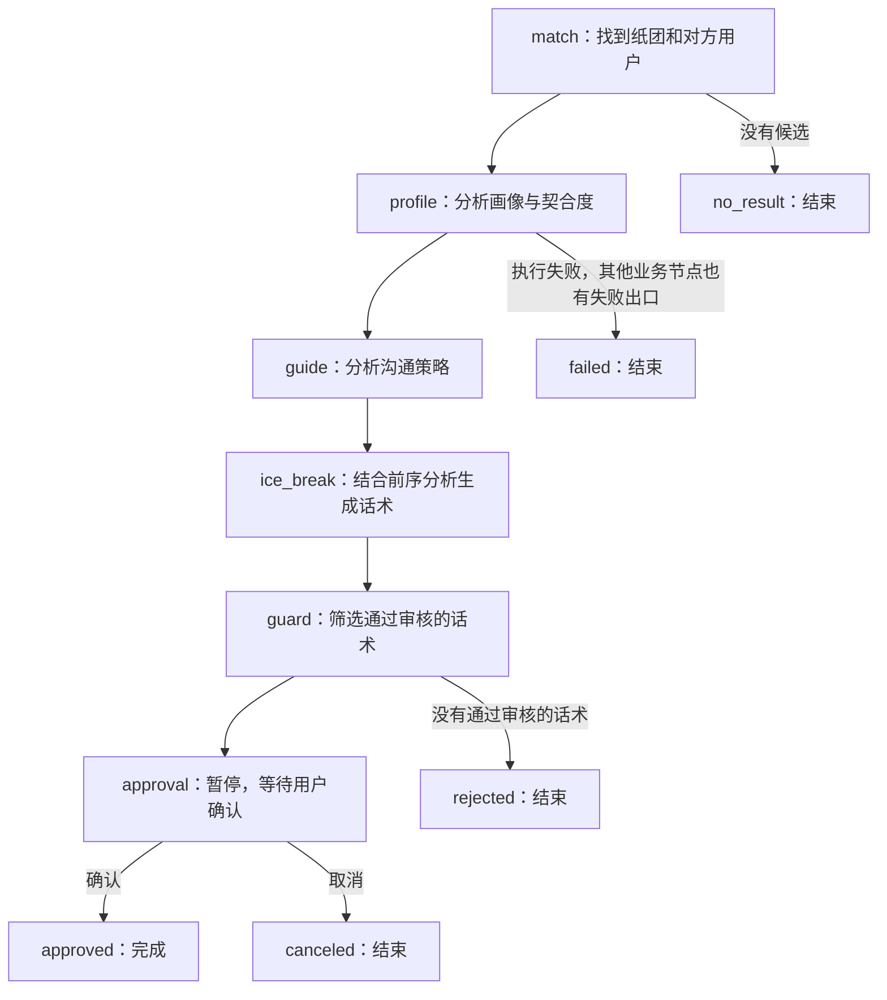

# 从一条业务流程读懂项目里的 LangGraph

第一次阅读只看页面的“智能全流程”，它对应 `/api/pick/runs`。普通“拾纸团盲盒”走的是另一条短流程，先把这两个入口区分开。

这份导读的目标是：你能指出每一步读了什么、写了什么，解释失败后为什么停止，以及用户确认后如何继续。先理解行为，再记框架名词。

## 第一步：先用一个故事理解流程

假设用户小明想找人聊天：系统先为他匹配一张纸团，分析双方兴趣，给出沟通策略，再生成三条开场白；审核后让小明选一句，确认后进入聊天。



图中的 `profile` 等是程序中的节点名。图决定执行顺序；节点内部才负责查数据、调用模型或处理结果。

## 第二步：运行一次不会调用模型的演示

在项目根目录的 PowerShell 中执行：

```powershell
.\.venv\Scripts\python.exe .\scripts\learn_pick_workflow.py
```

它执行项目真实的状态图，用固定示例代替领域 Agent，不连接 MySQL、不调用外部模型。SQLite 检查点放在临时目录，结束后清理。它是帮助你观察程序的学习工具，不是业务功能。

第一次只观察三件事：

1. 每经过一个节点，状态里多了哪个字段？
2. 到 `approval` 时为什么停下？`next` 是什么？
3. 重新打开检查点并确认后，为什么变成 `approved`？

再分别看失败和取消：

```powershell
.\.venv\Scripts\python.exe .\scripts\learn_pick_workflow.py --case fail
.\.venv\Scripts\python.exe .\scripts\learn_pick_workflow.py --case cancel
```

`fail` 在画像节点返回失败结果。你应该看到后面的沟通策略、生成和审核不再执行。`cancel` 先暂停在审批，再提交取消决定。

## 第三步：从 State 开始读代码

打开 [app/workflows/pick_workflow.py](app/workflows/pick_workflow.py)，先找 `PickWorkflowState`。

`State` 可以理解为“一次任务带着走的资料袋”。`PickWorkflowState` 这个 `TypedDict` 声明资料袋中允许有哪些字段；真正运行时的资料是 Python 字典，由路由创建。

任务刚开始时，资料大致是这样：

```python
{
    "run_id": "示例任务",
    "user_id": 7,
    "university": "测试大学",
    "city": "测试市",
    "province": "测试省",
    "status": "running",
    "error": None,
    "trace": [],
}
```

找到了纸团后，`match_node` 返回的只是更新：

```python
return {"match": payload, "status": "running", "error": None}
```

LangGraph 会把这份更新合并进状态，所以 `user_id` 等原有字段还在，后面的节点也能读取 `match`。节点不需要重新返回整个资料袋。

再看这一行：

```python
trace: Annotated[list[dict[str, Any]], operator.add]
```

它给 `trace` 指定了合并规则，也叫 reducer：新列表会追加到旧列表。其他没有指定 reducer 的字段，更新时默认覆盖该字段。比如第二个节点写 `status` 会替换旧状态；写一条 `trace` 则会保留已有轨迹并追加。普通字典字段不会因此自动逐层合并。

读完后尝试回答：**为什么画像节点返回的字典里没有 `match`，后面的破冰节点仍能读到匹配结果？**

## 第四步：看图是怎么连起来的

在同一文件找 `build_pick_workflow()`，只关注四种操作：

```python
graph = StateGraph(PickWorkflowState)       # 声明图使用的状态结构
graph.add_node("match", ...)               # 注册名为 match 的节点
graph.set_entry_point("match")             # 从 match 开始
graph.add_conditional_edges(...)           # 根据状态决定下一步
```

`build_pick_workflow()` 描述规则；`compile(checkpointer=...)` 把图编译成可以执行的对象；`ainvoke(state, config)` 才真正运行。

编译发生在 [app/pick_checkpoint.py](app/pick_checkpoint.py) 的 `init_pick_workflow_checkpoint()`。它给图接上 SQLite 检查点。开始执行发生在 [app/routers/pick_runs.py](app/routers/pick_runs.py) 的 `start_pick_run()`。

先理解这三个动作的区别：**构建图 → 编译图 → 执行图**。

## 第五步：沿着一份数据看节点协作

回到工作流文件，依次找 `profile_node`、`guide_node`、`ice_break_node`：

| 节点 | 读取什么 | 写入什么 |
| --- | --- | --- |
| match | 当前用户、目标地区 | `match`，包含纸团和对方用户 ID |
| profile | 当前用户 ID、匹配到的对方 ID | `profile_analysis` |
| guide | 当前用户 ID、匹配到的对方 ID | `conversation_guide` |
| ice_break | 双方 ID、画像分析、沟通策略 | `ice_break`，包含候选话术 |
| guard | 候选话术 | `approved_hints` 和审核结果，并过滤话术 |
| approval | 已通过审核的话术、用户决定 | `selected_hint`、`approval` 和最终状态 |

例如，画像分析给出“有摄影共同兴趣”，沟通策略给出“询问最近拍过的作品”。破冰节点把这些结论整理成 `analysis_context`，传给生成 Agent。

想确认模型是否真的收到这些结论，可以顺着读：

```text
ice_break_node
→ run_ice_break
→ call_ice_break_agent（在 supervisor_agent.py 中，它是一个工具函数）
→ IceBreak 子图
→ generate_hints（在 ice_break_agent.py 中，构造模型提示词）
```

函数放在 `supervisor_agent.py` 中，不代表这次要再调用 Supervisor 模型。显式拾取图直接调用这个工具包装函数，后者运行 IceBreak 子图。

模型并不包办全部计算：例如 MatchAgent 中的候选查询和评分主要由 Python/SQL 工具实现，LLM 参与工具调用。每个节点也不必都调用模型。

## 第六步：理解“失败怎么停”

看 `profile_node` 的两种结果：成功时更新分析结果并返回 `status="running"`；抛异常、结果格式无效或产物状态失败时，返回 `status="failed"` 和错误说明。

然后看路由函数：

```python
def route_after_profile(state):
    return "finish" if state.get("status") == "failed" else "guide"
```

节点负责产出结果和状态；路由函数读取状态，决定接下来去哪里。`finish` 再连接到 `END`。

因此，`return` 一个失败字典本身并不意味着整个图自动停止；停止来自你配置的条件边。

可以试着回答：**如果画像分析失败，但没有这条条件路由，后面的生成会遇到什么问题？**

## 第七步：理解“暂停后怎么恢复”

看 `approval_node` 中的：

```python
decision = interrupt({...})
```

首次执行到这里，图暂停，把待确认内容交给调用方，当前调用可以返回。并不是让一个 HTTP 请求一直挂着等用户点击。

此时 `snapshot.next` 包含 `approval`。当前实现的图状态 `status` 仍可能是 `running`；路由的 `_payload()` 根据待执行的审批节点，把返回给前端的状态显示为 `awaiting_approval`。

前端点击确认后，`resume_pick_run()` 使用：

```python
await graph.ainvoke(
    Command(resume={"approved": True, "hint": "你也喜欢摄影吗"}),
    config,
)
```

`config` 中的 `thread_id` 是 `pick-run:{run_id}`。同一个检查点存储配合同一个 `thread_id`，才能找到这次任务的状态。

恢复会重新执行被暂停的审批节点；执行到 `interrupt()` 时，它取得本次提交的决定，后续代码验证选择并写入最终状态。不能把它理解为保存并恢复普通 Python 函数的全部内存现场。

这也是审批节点不直接扣次数、写拾取记录的原因：节点可能重放。业务写入放在路由确认图已批准之后。这里理解副作用的位置即可，暂不展开数据库实现。

## 最后再把页面和后端接起来

你已经理解状态图之后，再按下面顺序看完整调用链：

```text
public/index.html：pickBottleSmart()
→ POST /api/pick/runs
→ start_pick_run() 创建初始状态并执行图
→ 图暂停在 approval，接口返回 awaiting_approval
→ 页面展示建议
→ approveSmartPick() 提交用户选择
→ POST /api/pick/runs/{runId}/resume
→ resume_pick_run() 用 Command 继续图
→ 图批准后路由写拾取记录
→ 页面创建/打开会话，把建议填进输入框
```

建议只填入输入框，并不自动发送给对方。服务重启后持相同 `runId` 可以继续待审批任务，当前页面没有刷新后自动找回任务的入口。

第一轮学完，只需用自己的话回答四件事：State 存什么、节点怎样更新它、条件边怎样选路、interrupt/Command 怎样配合。拿不准时回到演示输出找证据，再读对应函数。
