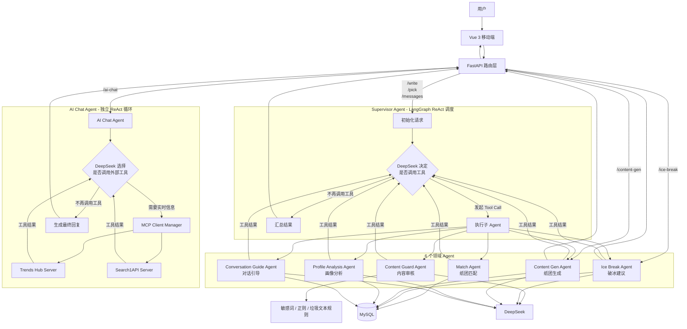
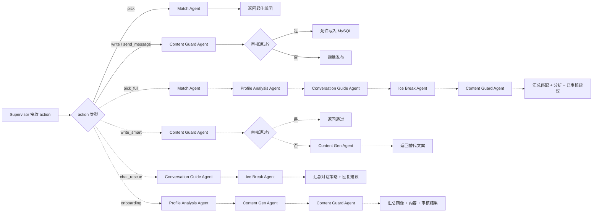
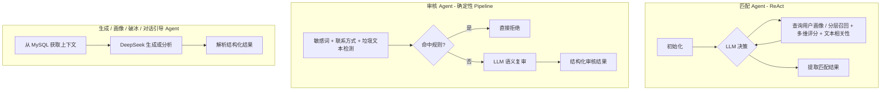
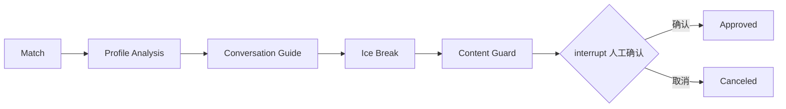

# The Player 多 Agent 协作流程图

## 1. 项目当前的真实调用架构

拾取功能有三条入口，讲解时需要区分：

- `/api/pick`：页面的普通拾取，Supervisor 只调用 MatchAgent。
- `/api/pick/full`：保留的 Supervisor 多 Agent 兼容接口。
- `/api/pick/runs`：页面的“智能全流程”，采用第 5 节的显式状态图，适合作为 LangGraph 面试展示主线。

下图展示 Supervisor 和各独立 Agent 的关系；可恢复的显式工作流见第 5 节。

### 关键说明

- 在 Supervisor 流程中，子 Agent 把结果返回 Supervisor，由它决定下一步；显式拾取工作流则由预先定义的图决定下一步。
- 当前 UI 中的“AI 生成”和“破冰建议”为了降低延迟，分别直接调用 `ContentGenAgent` 和 `IceBreakAgent`，不经过 Supervisor。
- `AIChatAgent` 不属于 Supervisor 的子 Agent，它是独立的 ReAct Agent，通过 MCP 动态调用热点、搜索和网页爬取工具。

## 2. Supervisor 支持的协作流程

> 实线表示简单任务，虚线表示复合任务。`pick_full` 已有兼容接口；`write_smart`、`chat_rescue`、`onboarding` 是 Supervisor 支持的动作，目前没有独立页面入口。

## 3. 各 Agent 内部工作流

## 4. 面试讲解口径

这个项目采用的不是“所有任务都交给 LLM 自主决策”，而是混合式多 Agent 架构：

1. 需要动态选择工具或连续调用多个 Agent 的任务，使用 Supervisor/ReAct。
2. 流程明确、稳定性优先的任务，使用确定性 LangGraph Pipeline。
3. 单一能力且延迟敏感的 UI 请求，直接调用领域 Agent，避免 Supervisor 增加额外的模型调用。
4. 外部实时信息查询由独立 AIChatAgent 通过 MCP 完成，与核心社交工作流解耦。

## 5. 新增：可恢复的完整拾取工作流

`/api/pick/runs` 不再依赖 Supervisor 的提示词规划，而是使用显式 LangGraph：

工作流通过独立 SQLite checkpointer 保存 `run_id`、匹配结果、审核结果和待审批建议。服务重启后可以用同一个 `runId` 恢复；审批只能选择已经通过 ContentGuard 的文本，真正的 `pick_records` 写入由路由层在确认后执行。

节点之间通过共享状态传递结果：画像节点写入 `profile_analysis`，对话引导节点写入 `conversation_guide`；破冰节点读取这两项，将兴趣标签、契合度、话题和回复策略整理为 `analysis_context`，放入生成提示词。这样，调整前面的分析结论会改变后续模型收到的上下文。单独调用聊天 AI 辅助时，上游分析是可选的，仍可仅根据画像和聊天记录生成建议。

## 6. 实习面试展示主线

本项目重点展示“如何用 LangGraph 管理一个需要用户确认的业务流程”。可以围绕以下四个问题结合代码讲解：

| 面试问题 | 对应实现 | 需要讲清的内容 |
| --- | --- | --- |
| 状态图里的 State 有什么作用？ | `PickWorkflowState`、各节点返回的字典 | 节点读取已有状态并返回更新；普通字段覆盖，`trace` 通过 `operator.add` 累加。 |
| 多个 Agent 如何协作？ | `profile_analysis`、`conversation_guide` → `analysis_context` → IceBreak | 前序结论写入共享状态，后续生成节点消费这些结果；顺序调用和传递结果是两件事。 |
| 为什么使用条件边？ | `route_after_match` 等路由函数 | 无候选、节点失败、审核未通过会提前结束，成功才进入下一步。 |
| 怎样等待用户确认并继续？ | `interrupt`、`AsyncSqliteSaver`、`Command(resume=...)` | 图在审批节点暂停，检查点保留状态；恢复时使用同一 `thread_id`，审批节点会重新执行，因此该节点不做数据库写入。 |

设计取舍也可以直接解释：拾取全流程的业务顺序明确，所以用显式图控制；开放式工具选择保留 Supervisor/ReAct。简单匹配仍走短流程，用户需要分析和破冰建议时再选择“智能全流程”。

演示时先运行 `python -m pytest tests/test_pick_workflow.py -q`，展示节点协作、失败终止、审批确认/取消和重新打开 SQLite 后继续审批。测试执行真实 LangGraph，模型与数据库查询使用替身，验证编排行为；生成内容的实际质量需另外观察真实模型运行结果。

当前跨服务重启恢复指后端持相同 `runId` 继续待审批任务；页面刷新后自动找回任务尚未接入。介绍检查点时应区分图状态和 MySQL 业务数据，两者分别存储。
